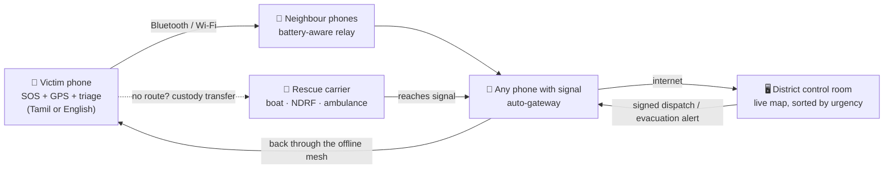

# MeshAlive

**India's offline disaster-response network.** When cyclones and floods take down mobile towers, MeshAlive still gets an SOS from a victim's phone to the district control room, and gets the control room's answer back to the victim, using only the phones people already own.

Phones connect directly over Bluetooth and Wi-Fi (Google Nearby Connections) and relay messages hop by hop. Rescue boats, NDRF teams and ambulances carry messages out of dead zones. The first phone that finds signal uploads everything to a live district dashboard. Dispatch messages and evacuation alerts flow back through the same offline mesh.

Built for the **SevaFirst Innovation Challenge** · Theme 5 *Surakshit Bharat* (Safety, Digital Public Infrastructure) · Track A (Product) · Level 3.

---

## The problem

- Cyclones and floods regularly knock out towers and power for days. People who are trapped cannot call, message or share their location, during exactly the hours when rescue matters most.
- Control rooms work blind: they don't know who needs help, where, how many people, or how urgently.
- Existing offline apps are **chat apps**. They don't reach rescuers, don't prioritise, and drain the batteries of the phones relaying for others.

## The solution: a complete loop, not a chat app



| | Bridgefy / Briar | Meshtastic / goTenna | **MeshAlive** |
|---|---|---|---|
| What it is | Chat between phones | Chat over LoRa radios | **End-to-end disaster response** |
| Extra hardware | None | ₹2,500+ radio per person | **None** |
| Reaches rescuers | ✗ | ✗ | **Live district dashboard** |
| Answer back to the victim | ✗ | ✗ | **Dispatch + evacuation alerts through the offline mesh** |
| Prioritises | ✗ | ✗ | **Triage urgency 0–100; most urgent sent first** |
| No phone in range | Waits | Waits | **Rescue carriers physically carry it out** |
| Battery | Flooding drains everyone | Flooding | **Battery-aware routing: 147× fewer transmissions, weakest phone keeps 2× battery** |
| Language | English | English | **Tamil SOS screens** |
| Fake alerts | n/a | n/a | **Control-room commands are cryptographically signed** |

---

## How MeshAlive meets the SevaFirst criteria

| SevaFirst asks | Where MeshAlive answers it |
|---|---|
| **Problem clarity**: observed, precise, worth solving | About screen and this README: towers fail in cyclones and floods; victims cannot reach control rooms; control rooms work blind. |
| **Originality**: what is new vs. what exists | A complete loop rather than a chat app: triage-scored SOS → battery-aware mesh → rescue carriers → district dashboard → signed dispatch and evacuation alerts back to phones with no signal (comparison table above). |
| **Demonstrated feasibility**: built, tested, evidence | Working APK and dashboard. **Impact → Evidence** records every real field-test delivery (success rate, median round trip, hops, phones met, relays, carrier handoffs) and **exports a field-trial report** for the submission. 49 automated tests. |
| **Cost**: per unit, who pays | **Impact → Planner → Cost and who pays**: ₹0 per citizen, ₹0 for carriers (existing phones), ₹0 for the control room (any browser); the district authority runs the awareness drive. |
| **Beneficiary impact**: who, how many, how much | **Impact → Planner**: for any area and adoption level, the real routing engine computes how many people can get an SOS to the control room (e.g. 1 km² ward, 1,000 app users, 4 people per phone → **3,731 of 4,000 people**), with and without rescue carriers. |
| **Scalability**: another district | Same app and dashboard everywhere. The planner's **adoption curve** shows how many installs a new district needs before coverage jumps; the simulator scales to 1,000+ phones. |
| **Level 3**: prototype with a pathway to deployment | Pilot plan below: one ward, the district control room, local NDRF/SDRF boats as carriers, measured with the built-in evidence report. |

## Features

### For people in danger
- **Guided first run:** welcome, language (English / தமிழ்), household details and role (citizen, rescue carrier or control-room gateway).
- **Safe SOS:** a 3-second full-screen countdown with *Cancel* and *Send now*, so a stray tap never sends a false alarm.
- **One-tap SOS** with GPS, plus quick buttons: *Medical help*, *Trapped*, *Water / food*.
- **Situation report** (set once, sent with every SOS): people, trapped, injured, elderly, children, disabled, water level (knee / waist / chest / roof). It is scored on the phone into an **urgency 0–100**. Example: 3 people, trapped, elderly, water at waist = **81 · CRITICAL**.
- **"I'm safe" check-in**, so the control room knows which households need no rescue.
- **Help-is-coming banner:** when the control room dispatches a team, the victim's phone shows *"🚤 Rescue team on the way — Boat 7, stay on the roof"*, even with no signal.
- **Evacuation alerts** arrive as a full-width red banner plus an alarm notification. They are re-shared with every phone that comes into range later.
- **Tamil:** one tap on **தமிழ்** switches the SOS screens, situation report and navigation, with Tamil preset messages.

### For the network
- **Battery-aware Dijkstra routing** (default): picks paths that avoid phones about to die. Flooding and BFS are also available for comparison.
- **Urgency-ordered sending:** every relay keeps a priority queue keyed on urgency, which travels in clear in the packet header while the message itself stays encrypted.
- **Rescue carriers (store-carry-forward):** a phone switched to *Rescue carrier* mode accepts custody of any SOS that has no route and delivers it when it reaches a gateway or signal. The sender sees *"With carrier"*.
- **Auto-gateway:** any phone that gets internet uploads everything it is carrying, with no button press.
- **Store-and-forward** queue, TTL, duplicate suppression, delivery ACKs with hop count, and self-healing Bluetooth/Wi-Fi links.
- **Encryption:** message text is encrypted with AES-GCM on the phone and relays forward it without reading it.

### For the control room
- **District dashboard** (`dashboard/index.html`, opens in any browser): a live map of every SOS sorted by urgency, with counters for need help, critical, teams dispatched, households safe and people reported.
- **🚤 Dispatch team / ✅ Mark rescued** on each SOS. The message travels back through the mesh to the victim's phone, and the dashboard shows **"✓ victim's phone confirmed"** when it arrives.
- **📢 Broadcast** an evacuation or warning, in any language, to every phone in the mesh.
- **Signed commands:** every dispatch and broadcast is signed with HMAC-SHA256 using the mesh passphrase. Gateways reject anything unsigned, forged or more than 6 hours old, so knowing the channel name isn't enough to inject a fake evacuation order.
- **Demo data** button to show the dashboard without phones (local only, nothing is sent).

### For planners and judges (Impact tab)
- **Evidence:** real field-test statistics recorded on the phone (SOS delivered, success rate, median round trip, most hops, relays for others, phones met, rescue replies, carrier handoffs), with **Export report** to Downloads.
- **Planner:** coverage model for any district. Enter area, people with the app, phones with signal, rescue boats, radio range and household size; get the percentage of people who can reach the control room (mesh alone and with carriers), people covered, an adoption curve and a cost breakdown.
- **Routing:** the disaster simulator compares Flooding, BFS and Battery-aware Dijkstra on 50–1,000 phones, with scalability charts and CSV export.

---

## Results (simulator, 200 phones, 20 SOS, seed 42)

| | Flooding | BFS | **Battery-aware Dijkstra** |
|---|---|---|---|
| Delivered | 85 % | 100 % | **100 %** |
| Radio transmissions | 14,533 | 88 | **99** |
| Weakest phone's battery left | 0.0 % | 3.2 % | **6.3 %** |

Flooding kills phones and then loses messages. Dijkstra uses **147× fewer transmissions** and leaves the weakest phone with **2× the battery** of shortest-hop routing. At 1,000 phones, flooding needs about 103,000 transmissions per 20 SOS; routed delivery stays around 60.

---

## Live demo (about 5 minutes, 3–4 phones + laptop)

**Before:** install `MeshAlive.apk` on every phone; grant permissions; turn on Bluetooth, Wi-Fi and Location. On the gateway phone, open **Inbox → Send test alert** to confirm internet. Then open `dashboard/index.html` on the laptop, enter the channel shown in the Inbox and the mesh passphrase, and press **Connect**.

1. **Kill the network.** Victim and relay phones: airplane mode on, then Bluetooth back on. Leave the gateway online and project the dashboard.
2. **Make it multi-hop.** In a room every phone hears every other, so on **Network → Live map** switch off links to build a chain: Victim → Relay → Gateway.
3. **SOS.** On the victim phone, fill *My situation* (3 people, trapped, elderly, water at waist) and press **SOS**. A red packet moves across the map. The gateway rings, and a **CRITICAL 81** marker drops onto the projected dashboard.
4. **Close the loop.** On the dashboard press **🚤 Dispatch team** and type *"Boat 7 on the way, stay on the roof"*. Seconds later the offline victim phone shows a green **Rescue team on the way** banner, and the dashboard shows **✓ victim's phone confirmed**.
5. **Broadcast.** Send an **EVACUATE** alert in Tamil from the dashboard. Every phone in the mesh, with no signal, shows it.
6. **Rescue carrier.** Cut all links on one phone and send an SOS; it shows *Queued*. Bring a phone in *Rescue carrier* mode next to it: the status changes to *With carrier*. Walk the carrier to the gateway, and the SOS appears on the dashboard.
7. **Language.** Tap **தமிழ்** on a victim phone and send the Tamil preset. The dashboard still gets structured triage.

**Tips:** start the app on all phones 2–3 minutes early. Turn **Settings → Auto-upload when signal returns** off on relay phones that have mobile data, otherwise each one becomes a gateway and every SOS goes in one hop.

---

## Cost and path to deployment

- **Citizens:** ₹0. It's a free Android app on phones people already own; no SIM, data or account needed for the mesh.
- **Rescue carriers:** the phones NDRF/SDRF teams, boat crews and ambulance drivers already carry, switched to carrier mode.
- **Control room:** any browser. Alerts go over the free ntfy.sh channel, and the same JSON can go straight into a district Emergency Operations Centre through the built-in webhook (Settings → *Gateway webhook URL*).
- **Pilot:** one flood-prone ward or coastal block (for example in Chennai or Cuddalore), the district disaster management control room, and local NDRF/SDRF boats as carriers. Measure SOS-to-control-room time and SOS-to-dispatch time against the current phone-call baseline.
- **Scale:** state-wide app rollout through the state disaster management authority; alerts can mirror the national CAP alerting standard.

---

## Architecture

```
algorithms/            pure Kotlin module + JUnit tests
  Graph.kt             weighted mesh graph
  RoutingStrategy.kt   Flooding · BFS · Battery-aware Dijkstra (super-node trick for nearest gateway)
  Forwarding.kt        duplicate cache · TTL · priority queue · forwarding engine
  Triage.kt            situation report → urgency 0–100 → queue order
app/src/main/java/com/meshalive/app/
  mesh/   MeshManager (Nearby links, link-state, routing, carriers, alerts) · MeshService (foreground)
          Packet · Crypto (AES-GCM) · CloudRelay (upload) · ControlRoom (signed commands) · Notifier
  data/   Room: messages · store-and-forward queue · gateway inbox · Settings
  sim/    district simulator
  ui/     Home · Messages/Chat · Network map + routing log · Inbox · Simulator · Settings · About · Tamil
dashboard/index.html   district control room (Leaflet map, live channel, signed dispatch & broadcast)
```

**Packet types:** `SOS`, `MEDICAL`, `CHAT`, `SAFE` (check-in), `UPDATE` (control room → one victim), `ALERT` (control room → everyone, flooded), plus control traffic `LSA`, `PING`/`PONG`, `ACK`.

**How routing works:** every 5 s each phone floods a link-state advertisement (battery, gateway / carrier flags, neighbours with measured round-trip time). Every phone rebuilds the network graph and runs battery-aware Dijkstra once from a virtual super-node joined to all gateways, which gives every phone its next hop to the nearest gateway in O((V+E) log V). Edge cost is `α·normalisedRTT + β/max(battery,5) + γ` (α=1, β=50, γ=1, editable).

---

## Build and install

Requirements: JDK 17 or 21, and the Android SDK with platform 34.

```bash
./gradlew test
```

```bash
./gradlew assembleDebug
```

The APK is written to `app/build/outputs/apk/debug/app-debug.apk`; a copy is at `MeshAlive.apk`. Install it with:

```bash
adb install -r MeshAlive.apk
```

Or copy it to the phone and allow *Install unknown apps*. Phones need Google Play Services (for Nearby Connections and location).

**Tests (49):** routing (16), forwarding (9), triage scoring and urgency queue (6), signed control-room commands and channel parsing (6), coverage planner (6), field-evidence report (3), simulator (3). The command-signature tests use reference values computed independently, which the dashboard's JavaScript signer also matches.

---

## Known limitations

- Bluetooth range is about 10–30 m indoors, so coverage depends on phone density. Rescue carriers and auto-gateways reduce this dependence but don't remove it.
- Nearby Connections handles roughly 4–8 direct links per phone.
- The mesh passphrase is shared, so encryption and command signing are only as strong as that secret. A production version would give each control room its own signing key pair.
- ntfy.sh is a public relay: anyone who knows the channel name can read alerts, though not forge commands. Use a self-hosted ntfy server or the webhook for production.
- Some phone makers' battery savers stop background apps; use Settings → *Keep relay alive in background*.
- Needs Google Play Services.
